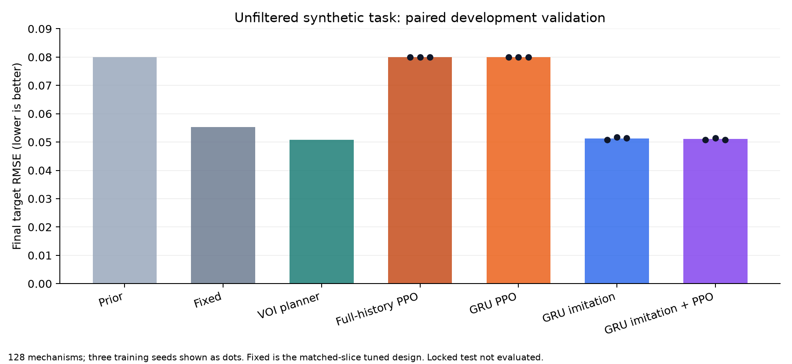

# Experimental Scientist RL

**RL (reinforcement learning) and Bayesian planning for cost-aware experimental design.**

A standalone Python research project in which an agent purchases experiments on a hidden synthetic regulatory system, then chooses a final intervention. It asks whether experiments help, whether adapting them helps, and whether PPO adds value beyond imitation learning.

The project includes actual PPO training code and measured runs. It is a **development research release**: locked-test evaluation and structural generalization remain unqualified, and an RL-specific advantage has not been established.



## What is implemented

- A NumPy/SciPy float64 dynamical simulator, independent cultures for each experiment, priced evidence, and independent final scoring.
- A restricted scientific environment with 36 experiments and 9 commitments; public action masks and a separate private evaluator.
- Prior-informed, fixed, additive-response, random, EIG, decision-value and direct-assay Bayesian-optimization baselines.
- Full-history feedforward PPO and a GRU actor–critic with whole-episode updates, padding masks, action masks, and memory resets.
- The same recurrent architecture trained by imitation, PPO, and imitation followed by PPO.
- A complete CPU path and a measured Apple MPS path; automatic selection benchmarks complete workloads.
- Reproducible configurations, scientific and training-mechanics tests, recorded development results, and JSON episode replay.

## Results and their limits

The original feasibility-conditioned task is solved by a strong fixed design: both fixed and adaptive methods reach final RMSE **0.02891**. Adaptive stopping saves experimental cost, but adds no final-quality gain. This negative result is preserved.

A documented development revision retains unreachable targets and removes the attainability condition from both generation and the inference prior. It keeps the dynamics, targets, actions, costs, and strong fixed baselines. On 128 independent validation mechanisms:

| Method | Final target RMSE | Mean variable assay cost |
|---|---:|---:|
| Prior-informed commitment | 0.08000 | 0 |
| Fixed design, selected after exhaustive affordable-design search | 0.05399 | 6.40 |
| Adaptive decision-value planner | 0.04814 | 4.58 |
| Private informed reference | 0.04814 | 0, privileged |

The planner recovers **14.6%** more of the prior-to-reference error gap than the empirically tuned exhaustive-search fixed design; the paired improvement intervals are positive on this development set. The search covers 10,373 candidates and uses 512 calibration mechanisms. It is not an exact optimization of expected fixed-design performance.

On a separate paired development slice, converged full-history and recurrent imitation policies approach the planner's final quality. Completed recurrent fine-tuning runs use **three seeds with at least 100,000 PPO transitions per seed**. These runs establish a real RL training pipeline; they do not establish a robust PPO advantage. Full-history imitation is a strong equal-information comparator.

Read [the results guide](docs/results.md) and the raw records under `reports/`. Do not combine results from different validation slices as though they were paired. These are synthetic-system findings, not wet-lab or therapeutic evidence.

## Quick start

Clone this repository, open its directory in a terminal, and use native Python 3.12. The measured reference uses Python 3.12.1 on an M3 Max; CUDA is not required.

```bash
PROJECT="$PWD"
python3.12 "$PROJECT/scripts/bootstrap.py"
"$PROJECT/.venv/bin/experimentlab" doctor
"$PROJECT/.venv/bin/experimentlab" validate-science --suite diagnostic
"$PROJECT/.venv/bin/python" -m pytest "$PROJECT/tests" -c "$PROJECT/pyproject.toml"
"$PROJECT/.venv/bin/experimentlab" feasibility --quick --output "$PROJECT/runs/quick-check"
```

The quick run checks execution; it is not a substitute for the complete feasibility protocol.

## Run RL and reproduce comparisons

```bash
PROJECT="$PWD"
"$PROJECT/.venv/bin/experimentlab" train --smoke --device cpu --output "$PROJECT/runs/learning-smoke"
"$PROJECT/.venv/bin/experimentlab" benchmark --output "$PROJECT/runs/device-benchmark"

# Revised scientific assessment, then gated three-seed learning comparisons.
"$PROJECT/.venv/bin/python" "$PROJECT/scripts/research_stage.py" \
  --stage revise --transitions 100000 --output "$PROJECT/runs/reproduced-v3"

# Strengthen the fixed frontier and converge the imitation baseline.
"$PROJECT/.venv/bin/python" "$PROJECT/scripts/strengthen.py" fixed \
  --output "$PROJECT/runs/reproduced-v3"
"$PROJECT/.venv/bin/python" "$PROJECT/scripts/strengthen.py" imitation \
  --output "$PROJECT/runs/reproduced-v3"

# Conservative PPO refinement of the converged recurrent imitation policy.
"$PROJECT/.venv/bin/python" "$PROJECT/scripts/fine_tune.py" \
  --transitions 100000 --output "$PROJECT/runs/reproduced-v3"
"$PROJECT/.venv/bin/python" "$PROJECT/scripts/evaluate_research.py" \
  --output "$PROJECT/runs/reproduced-v3"
```

The larger commands can take considerably longer than the smoke check. Checkpoints and fresh outputs go into ignored `runs/`; pretrained weights are not bundled. The frozen dependency versions are in `requirements.lock`.

## Design and evidence

- [Scientific protocol](docs/protocol.md)
- [Development revisions and preserved negative results](docs/revisions.md)
- [Results and publication scope](docs/results.md)
- [Build specification](autonomous_scientist_build_spec.md)
- [Publication manifest](docs/publication-manifest.json)

The public snapshot excludes credentials, virtual environments, checkpoints, live training outputs, and a private document handoff link. It was prepared separately from the active development checkout. Original development hashes are retained in the evidence; publication-only changes and redactions are documented in the manifest.

A full GUI is not included. The current replay command exposes the recorded target, purchased observations, actions, budget, and post-episode evaluation. A future renderer should make this evidence easier to inspect while keeping private mechanism information out of the policy interface.
