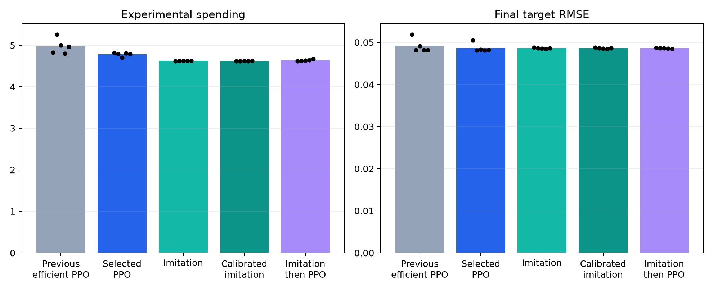

# Experimental Scientist RL

**RL (reinforcement learning) and Bayesian planning for cost-aware experimental design.**

A standalone Python research project in which an agent purchases experiments on a hidden synthetic regulatory system, then chooses a final intervention. It asks whether experiments help, whether adapting them helps, and whether PPO adds value beyond imitation learning.

The project includes actual PPO training code and measured runs. It is a **synthetic research release** with four completed locked continuous-parameter tests. Reward-only PPO now learns useful adaptive experiments and beats a strong fixed design. Strong imitation remains more cost-effective; PPO-specific added value over imitation is not established. Structural generalization and real biology remain unqualified.



## Latest: stronger PPO, a remaining imitation gap

Another **4,096 fresh locked mechanisms**, all **five retained seeds**, and **50,011,727 completed new training interactions** show useful progress. The architecture, reward, fees and strong baselines remain unchanged.

| Method | Final target RMSE | Variable assay cost | Mean return |
|---|---:|---:|---:|
| Previous efficient PPO | 0.04912 | 4.969 | -0.31988 |
| Updated PPO | 0.04865 | 4.782 | -0.31384 |
| Strong imitation | 0.04859 | 4.623 | -0.31211 |
| Equally calibrated imitation | 0.04858 | 4.621 | -0.31201 |

Versus the previous efficient PPO, spending falls **3.8%**, target MSE decreases, and return improves; all three hierarchical 95% intervals favor the update. The point estimate closes **54.2% of the previous cost gap**. It still spends **3.4% more than imitation**. Quality meets the declared noninferiority margin, but the cost and return criteria fail the full closure screen. No PPO advantage over imitation is established.

Read [the complete v6 report](docs/ppo_efficiency_v6.md), [raw summary](reports/ppo-efficiency-v6/summary.json), and [frozen protocol](reports/ppo-efficiency-v6/fresh-locked/freeze.json). The test was not used to retune anything. Two final restart pilots were interrupted by disk exhaustion and excluded from promotion; their incomplete compute is separately bounded in the report. All earlier findings below remain historical evidence.

## What is implemented

- A NumPy/SciPy float64 dynamical simulator, independent cultures for each experiment, priced evidence, and independent final scoring.
- A restricted scientific environment with 36 experiments and 9 commitments; public action masks and a separate private evaluator.
- Prior-informed, fixed, additive-response, random, EIG, decision-value and direct-assay Bayesian-optimization baselines.
- Full-history feedforward PPO and a GRU actor–critic with whole-episode updates, padding masks, action masks, and memory resets.
- The same recurrent architecture trained by imitation, PPO, and imitation followed by PPO.
- A complete CPU path and a measured Apple MPS path; automatic selection benchmarks complete workloads.
- Reproducible configurations, scientific and training-mechanics tests, recorded development results, and JSON episode replay.

## Results and their limits

The original feasibility-conditioned task is solved by a strong fixed design: both fixed and adaptive methods reach final RMSE **0.02891**. Adaptive stopping saves experimental cost, but adds no final-quality gain. This negative result is preserved.

A documented development revision retains unreachable targets and removes the attainability condition from both generation and the inference prior. It keeps the dynamics, targets, actions, costs, and strong fixed baselines. On 128 independent validation mechanisms:

| Method | Final target RMSE | Mean variable assay cost |
|---|---:|---:|
| Prior-informed commitment | 0.08000 | 0 |
| Fixed design, selected after exhaustive affordable-design search | 0.05399 | 6.40 |
| Adaptive decision-value planner | 0.04814 | 4.58 |
| Private informed reference | 0.04814 | 0, privileged |

The planner recovers **14.6%** more of the prior-to-reference error gap than the empirically tuned exhaustive-search fixed design; the paired improvement intervals are positive on this development set. The search covers 10,373 candidates and uses 512 calibration mechanisms. It is not an exact optimization of expected fixed-design performance.

The collapse follow-up trained five seeds with **20,002,755 main physical interactions**. A reward-only curriculum teaches intervention interpretation before releasing experiment selection. On 1,024 new locked mechanisms, curriculum PPO improves return over the exhaustive fixed design by **0.06877**, with a hierarchical 95% interval **[0.05166, 0.08358]**. Strong imitation still has better return and spends less.

A second follow-up investigates that spending gap on development data, retaining all prices, the GRU64 architecture and strong baselines. Five-seed paired-return continuation and public-price logit calibration use another **5,000,839 main interactions**. On another **2,048 fresh locked mechanisms**:

| Method | Final target RMSE | Mean variable assay cost | Mean return |
|---|---:|---:|---:|
| Original curriculum PPO | 0.04836 | 5.391 | -0.31728 |
| Paired-return PPO + public-price calibration | 0.04860 | 4.949 | -0.31501 |
| Strong imitation | 0.04790 | 4.622 | -0.30582 |
| Adaptive decision-value planner | 0.04763 | 4.644 | -0.30349 |
| Preserved exhaustive fixed design | 0.05439 | 6.400 | -0.38508 |

PPO spending falls **8.2%**: cost reduction 0.4422, 95% interval **[0.2861, 0.6076]**. Raw MSE meets the predeclared noninferiority margin of 0.0001. The net-return improvement interval **[-0.00137, 0.00484]** includes zero, so the full efficiency screen fails. This is evidence for lower spending with bounded quality loss, not an established overall utility win. The public-price calibration is explicit post-processing, not a PPO gradient discovery; imitation receives the same calibration search.

Read [the results guide](docs/results.md), [PPO collapse investigation](docs/ppo_followup.md), and [cost-efficiency report](docs/ppo_cost_efficiency.md). Raw rows, protocols, failed controls, curves and freeze hashes are under `reports/`. Each test uses different mechanisms; compare methods within a study. Familiar motif support and zero culture-offset SD limit these synthetic findings.

## Quick start

Clone this repository, open its directory in a terminal, and use native Python 3.12. The measured reference uses Python 3.12.1 on an M3 Max; CUDA is not required.

```bash
PROJECT="$PWD"
python3.12 "$PROJECT/scripts/bootstrap.py"
"$PROJECT/.venv/bin/experimentlab" doctor
"$PROJECT/.venv/bin/experimentlab" validate-science --suite diagnostic
"$PROJECT/.venv/bin/python" -m pytest "$PROJECT/tests" -c "$PROJECT/pyproject.toml"
"$PROJECT/.venv/bin/experimentlab" feasibility --quick --output "$PROJECT/runs/quick-check"
```

The quick run checks execution; it is not a substitute for the complete feasibility protocol.

## Run RL and reproduce comparisons

```bash
PROJECT="$PWD"
"$PROJECT/.venv/bin/experimentlab" train --smoke --device cpu --output "$PROJECT/runs/learning-smoke"
"$PROJECT/.venv/bin/experimentlab" benchmark --output "$PROJECT/runs/device-benchmark"

# Revised scientific assessment, then gated three-seed learning comparisons.
"$PROJECT/.venv/bin/python" "$PROJECT/scripts/research_stage.py" \
  --stage revise --transitions 100000 --output "$PROJECT/runs/reproduced-v3"

# Strengthen the fixed frontier and converge the imitation baseline.
"$PROJECT/.venv/bin/python" "$PROJECT/scripts/strengthen.py" fixed \
  --output "$PROJECT/runs/reproduced-v3"
"$PROJECT/.venv/bin/python" "$PROJECT/scripts/strengthen.py" imitation \
  --output "$PROJECT/runs/reproduced-v3"

# Conservative PPO refinement of the converged recurrent imitation policy.
"$PROJECT/.venv/bin/python" "$PROJECT/scripts/fine_tune.py" \
  --transitions 100000 --output "$PROJECT/runs/reproduced-v3"
"$PROJECT/.venv/bin/python" "$PROJECT/scripts/evaluate_research.py" \
  --output "$PROJECT/runs/reproduced-v3"
```

The later study workflows are `scripts/ppo_followup.py`, `scripts/ppo_v4_main.py`, `scripts/ppo_cost_study.py` and `scripts/ppo_cost_select.py`. Read the reports and scripts before launching them. The v6 continuation is `scripts/ppo_efficiency_v6.py`, selection is `scripts/ppo_v6_select.py`, and the frozen sharded evaluator is `scripts/ppo_v6_locked.py`. Their defaults point to recorded study directories: use a separate project/output copy for new training. Never select methods using saved locked outcomes. The locked runners refuse to overwrite completed results. Pretrained weights are excluded, so report rendering is available from the evidence but trained-policy reruns require reproducing training.

The latest 73 MiB raw cost-test JSON is stored losslessly as `reports/ppo-cost-v5/fresh-locked/results.json.gz`; Python `gzip.open` reads it directly. `scripts/report_ppo_cost.py` supports this compressed record without retraining. Earlier locked records retain ordinary JSON. Machine paths were redacted; original hashes refer to the original development artifacts.

The larger commands can take considerably longer than the smoke check. Checkpoints and fresh outputs go into ignored `runs/`; pretrained weights are not bundled. The frozen dependency versions are in `requirements.lock`.

## Design and evidence

- [Scientific protocol](docs/protocol.md)
- [Development revisions and preserved negative results](docs/revisions.md)
- [Results and publication scope](docs/results.md)
- [Build specification](autonomous_scientist_build_spec.md)
- [Original publication manifest](docs/publication-manifest.json)
- [Completed-study update manifest](docs/publication-update-2026-10-26.json)
- [V6 publication manifest](docs/publication-update-v6.json)

The public snapshot excludes credentials, virtual environments, checkpoints, live training outputs, and a private document handoff link. It was prepared separately from the active development checkout. Original development hashes are retained in the evidence; publication-only changes and redactions are documented in the manifest.

A full GUI is not included. The current replay command exposes the recorded target, purchased observations, actions, budget, and post-episode evaluation. A future renderer should make this evidence easier to inspect while keeping private mechanism information out of the policy interface.
