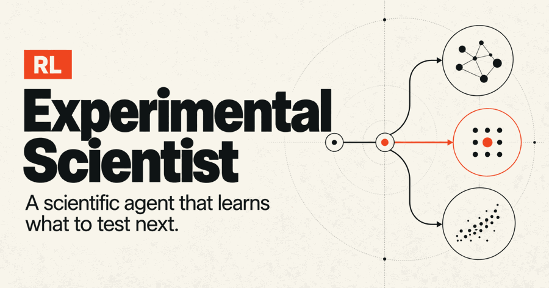

# Experimental Scientist RL

**A scientific agent that learns what to test next.**



<sub>Conceptual workflow. [Watch the MP4](docs/media/experimental-scientist.mp4) · [Download the still cover](docs/media/experimental-scientist.png)</sub>

Imagine a virtual laboratory with a biological network whose wiring you cannot see. You want two outputs to reach their target values. You can run experiments to learn how the system behaves, but every experiment uses part of a limited budget.

This project trains a small reinforcement-learning agent to decide **which experiment to run, what to do after seeing its result, and when to stop testing and choose a final intervention**. All experiments take place in a numerical simulator.

## What happens in one episode?

1. **Get the goal.** The agent receives target values, baseline measurements, available actions, prices, and a budget.
2. **Choose a test.** It selects a control to suppress (or a no-intervention control), a dose, a response duration, and which pair of variables to measure.
3. **Pay and observe.** The simulator runs the experiment on fresh cultures. The agent sees the measurements it purchased.
4. **Adapt the next choice.** Based on those results, it can run another test or stop. The main pilot allows at most four experiments within a budget of eight virtual cost units.
5. **Commit and evaluate.** It chooses a final intervention. A separate evaluator tests it on independent cultures and scores target error, assay spending, and intervention effort.

**Choose → experiment → observe → adapt → commit.**

For example, the agent might first measure downstream outcomes after suppressing one control. Its observations can lead it to investigate another control with a cheaper measurement, or to stop because it already has enough evidence. This is what makes the strategy *adaptive*. A fixed schedule preselects its tests before observing any results.

## What can the agent see and do?

| Part | In this project |
|---|---|
| Hidden system | Eight simulated variables connected by an unknown regulatory mechanism |
| Evidence | Baseline measurements and the noisy results of purchased experiments |
| Experiment choices | 36 combinations of intervention, duration, and measurement panel |
| Final choices | Nine interventions, including leaving the system unchanged |
| Resources | Budget 8; at most four purchased experiments in the main pilot |
| Fresh samples | Every experiment uses fresh cultures; final scoring uses an independent batch |
| Private information | True mechanism parameters, unpurchased observations, oracle rankings, and final-evaluation randomness stay outside the policy input |

The cost units are part of the simulator, not real laboratory prices. The policy receives public observations and action masks; trusted simulator/evaluator code holds the hidden system.

## What is being learned?

The agent must learn both **how to gather useful evidence** and **how to turn that evidence into an intervention**. Buying more tests is worthwhile only when their benefit justifies their cost.

| Approach | How it chooses |
|---|---|
| Fixed experimental design | Runs a schedule selected on development data |
| Bayesian decision-value planner | Updates a belief over possible mechanisms and estimates which test could improve the final decision |
| Imitation learning | Learns to reproduce the planner's decisions from public experiment histories |
| PPO reinforcement learning | Learns from experiments and rewards, using a reward-only curriculum to develop interpretation and experiment-selection skills |

The learned comparisons use the same 64-unit recurrent neural architecture. Training budgets differ and are reported. Public-price logit calibration is reported separately from PPO gradient learning.

## What did the experiments show?

- **Strong fixed designs matter.** The original feasibility-conditioned task was already solved by a fixed schedule. That result is preserved.
- **Adaptive experiments can help.** A documented development revision retains unreachable targets. On fresh tests of that task, useful adaptive PPO policies beat the preserved strong fixed design.
- **PPO has improved, but imitation remains cheaper.** More training reduced PPO's spending and target error and improved its return. A PPO advantage over strong imitation has not been established.

The latest frozen comparison uses **4,096 new mechanisms and all five retained training seeds**:

| Method | Final target error (RMSE ↓) | Experimental cost ↓ |
|---|---:|---:|
| Strong fixed design | 0.05521 | 6.400 |
| Previous efficient PPO | 0.04912 | 4.969 |
| Updated PPO | 0.04865 | 4.782 |
| Strong imitation | 0.04859 | 4.623 |

RMSE measures how far final outputs are from their targets. Experimental cost sums the purchased assays. The common baseline setup costs three additional units, outside both the budget of eight and this cost column. Lower is better for both metrics, and the full evaluation also accounts for intervention effort.

Updated PPO spends **3.8% less than its previous version**, with favorable paired 95% intervals for cost, target MSE, and return. It removes **54.2% of the previous cost gap** at the point estimate, but still spends **3.4% more than imitation**. The predeclared full efficiency-parity screen failed.

These are **synthetic-system results within familiar mechanism families**. They do not establish wet-lab usefulness, structural generalization, or therapeutic efficacy. Training/development and final tests are separated; methods are frozen before final scoring.

Read [the complete measured report](docs/ppo_efficiency_v6.md) for confidence intervals, failed controls, compute accounting, and limitations. [The results guide](docs/results.md) keeps the earlier studies and negative findings separate.

## Run a small demonstration

Clone the repository, open its directory in a terminal, and use native Python 3.12. CPU execution is supported; CUDA is not required.

```bash
PROJECT="$PWD"
python3.12 "$PROJECT/scripts/bootstrap.py"
"$PROJECT/.venv/bin/experimentlab" doctor
"$PROJECT/.venv/bin/experimentlab" validate-science --suite diagnostic
"$PROJECT/.venv/bin/experimentlab" feasibility --quick --output "$PROJECT/runs/quick-check"
```

The quick command checks the simulator and bounded comparison pipeline. It does not reproduce the full published training study. A full GUI is not included.

To inspect a recorded episode, use [a public replay packet](reports/ppo-v4/replays/success.json) with the replay command:

```bash
PROJECT="$PWD"
"$PROJECT/.venv/bin/experimentlab" replay \
  --episode "$PROJECT/reports/ppo-v4/replays/success.json"
```

The packet separates purchased observations/actions from post-episode evaluation. Additional replays show [a policy failure](reports/ppo-v4/replays/policy-failure.json) and [an unreachable target](reports/ppo-v4/replays/unreachable-target.json).

## Explore the implementation and evidence

| Start here | What it explains |
|---|---|
| [Scientific protocol](docs/protocol.md) | Dynamics, actions, budgets, noise, and information boundaries |
| [Development revisions](docs/revisions.md) | Why the initial fixed-design success was preserved and how the task was revised |
| [Results guide](docs/results.md) | Which claims each study supports and what remains uncertain |
| [PPO collapse investigation](docs/ppo_followup.md) | Why early training stopped buying experiments and how the curriculum helped |
| [Latest efficiency report](docs/ppo_efficiency_v6.md) | The new locked comparison, uncertainty, and remaining imitation gap |
| [Source package](src/experimentlab) | Simulator, environment, inference, baselines, and learning code |
| [Study workflows](scripts) | Bounded training, selection, evaluation, reporting, and benchmarking scripts |
| [Tests](tests) | Scientific calculations, masks, recurrent histories, padding, checkpoints, and device paths |

For an initial learning smoke run:

```bash
PROJECT="$PWD"
"$PROJECT/.venv/bin/experimentlab" train --smoke --device cpu \
  --output "$PROJECT/runs/learning-smoke"
"$PROJECT/.venv/bin/python" -m pytest "$PROJECT/tests" -c "$PROJECT/pyproject.toml"
```

The generic CLI retains the original pilot's gates. Later revised studies use the workflows under `scripts/`, including `ppo_efficiency_v6.py`, `ppo_v6_select.py`, and `ppo_v6_locked.py`. Read their protocols before launching larger runs. Use a separate project/output copy: the default research paths contain recorded evidence, and completed locked results refuse overwrite. Never use saved test outcomes to select a new method.

Pretrained weights and demonstration binaries are excluded from this public release. Their hashes, configurations, training curves, and numerical results are retained. Reproducing trained-policy evaluation requires reproducing training. Gzip-compressed raw records preserve the numerical evidence without oversized Git blobs.

The reference calculations use NumPy/SciPy float64 on CPU; the neural models use PyTorch float32. Native CPU and Apple MPS paths have been measured. Current complete workloads favor CPU at this model size; benchmarks and their scopes are reported alongside the studies.

[Build specification](autonomous_scientist_build_spec.md) · [Original publication manifest](docs/publication-manifest.json) · [V3–V5 update manifest](docs/publication-update-2026-10-26.json) · [V6 publication manifest](docs/publication-update-v6.json) · [Documentation and cover update](docs/documentation-update-2026-10-29.json)

Original development hashes are provenance for the measured artifacts. Publication redactions and portability edits are recorded separately. The cover animation illustrates experiment selection; recorded results come from the simulator and frozen evaluation files.
