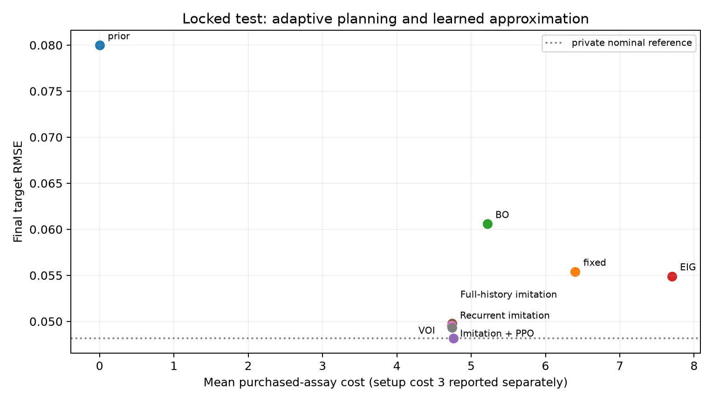
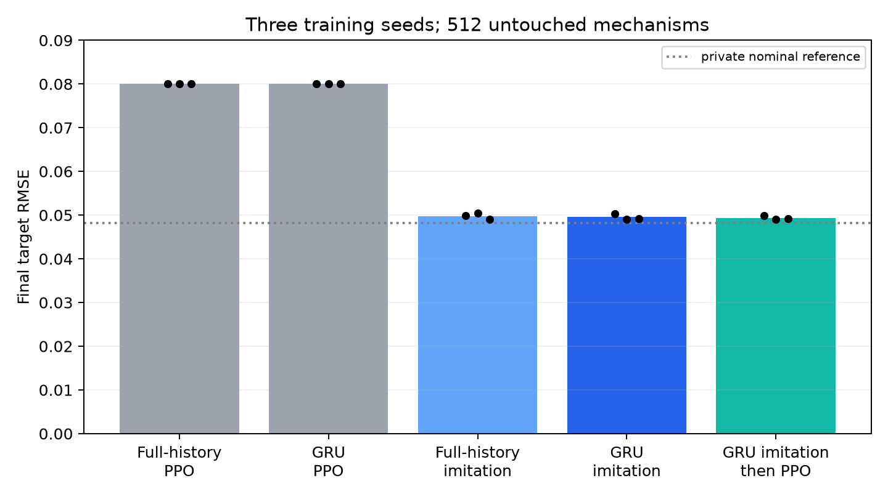

# Measured feasibility report

A useful adaptive experimental-design result was established after a documented development revision. A small learned policy approximates the strategy. PPO-specific added value was not established.

## Answers to the four questions

1. **Do experiments help after cost? Yes, within this synthetic family.** Prior-informed commitment returns -0.6400; adaptive VOI returns -0.3093 on 512 untouched mechanisms, with lower final error despite paying for experiments.
2. **Does adaptation improve on strong fixed designs? Yes, after removing attainability conditioning.** VOI improves return by 0.0860, 95% paired CI [0.0708, 0.1016], and recovers 18.4% more of the prior-to-reference raw error gap. It spends less and achieves lower error.
3. **Can a small learned policy reproduce the strategy? Approximately.** A 32,814-parameter GRU trained by imitation reaches aggregate RMSE 0.04954 versus VOI 0.04816, using three seeds. The full-history imitation model is similarly effective. The learned policy retains a small quality gap; this is an amortized-planning result.
4. **Does PPO add value over imitation? Not clearly in this protocol.** From-scratch PPO converges to buying no experiments. Conservative PPO after converged imitation changes return by 0.00167, with hierarchical 95% CI [-0.00409, 0.00881]. This does not establish an RL-specific improvement.

## Frozen test results

All methods use the same 512 mechanisms and goals. Learned rows aggregate all three seeds; none was selected using test outcomes. Fixed/random/EIG/BO/VOI share one posterior final selector. Learned commitments are evaluated separately. The common baseline assay costs 3 units outside the variable budget.

| Method | Final RMSE | Variable cost | Mean return | Success within 0.04 |
|---|---:|---:|---:|---:|
| prior | 0.08000 | 0.000 | -0.64000 | 0.00% |
| fixed | 0.05541 | 6.400 | -0.39535 | 60.74% |
| fixed quality | 0.05541 | 7.400 | -0.40535 | 60.74% |
| random | 0.06930 | 7.200 | -0.56970 | 27.15% |
| bo | 0.06059 | 5.217 | -0.43926 | 49.80% |
| eig | 0.05491 | 7.700 | -0.40324 | 61.72% |
| voi | 0.04816 | 4.761 | -0.30933 | 74.41% |
| history ppo | 0.08000 | 0.000 | -0.64000 | 0.00% |
| recurrent ppo | 0.08000 | 0.000 | -0.64000 | 0.00% |
| history imitation | 0.04980 | 4.745 | -0.32488 | 72.72% |
| recurrent imitation | 0.04954 | 4.739 | -0.32249 | 73.31% |
| recurrent imitation ppo | 0.04935 | 4.742 | -0.32082 | 73.63% |
| private nominal reference (privileged) | 0.04816 | 0.000 | -0.26172 | 74.41% |

The reference has private mechanism access and privileged zero variable assay cost. Unreachable targets remain in every reported average; its success rate is therefore below 100%. Lower absolute RMSE in the original admitted study cannot be compared directly with this unfiltered mixture.

## What changed, and what was preserved

The original feasibility-conditioned low-noise pilot was solved by a fixed design: fixed and VOI both reached RMSE 0.02891. A stronger 128-particle continuous check also failed the adaptivity screen. Those negative results remain in reports/feasibility-v1 and reports/research-v2.

The diagnosis was a simplifying prior constraint: knowing that the target is attainable can make an unmeasured sibling control inferable after its partner fails. The revision removes that conditioning from both generation and inference and retains unreachable targets. It preserves the simulator, primary readout noise, targets, actions, costs, final estimator and strong baselines. It was developed before opening the locked test. See revisions.md.

The strongest fixed search covers all affordable canonical assay multisets through four experiments, plus ordered-pair candidates. It examines 10,373 schedules on 512 calibration mechanisms. Zero-information no-intervention assays are pruned using the declared prior; public action masks do not use hidden information. This is exhaustive search over a declared finite design space with Monte Carlo calibration, not proof of a globally optimal expected fixed strategy.

## Scientific and learning protocol

Eight states form two regulatory pathways with four controls, two intermediates and two outcomes. The prior contains 32 sign/route motifs, independent control-gain scale Uniform(0.9, 1.05) and shared-rate scale Uniform(0.9, 1.1). All baseline activities are 0.5. Targets independently use 0.5 +/- 0.08. Controls suppress production; they never clamp outcomes.

The pilot has 36 experimental actions and 9 commitments: no intervention or eight single-control doses, durations 1/6, proxy/outcome panels. The variable budget is 8, with at most four purchased assays and eight fresh cultures per assay. Readout SD is 0.02. The primary revised study has culture-offset SD zero; robustness to culture variation remains a separate qualification. Locked scoring uses 128 fresh cultures, independent of every purchased assay. With zero culture variation those latent outcomes are deterministic.

Reference simulation uses NumPy/SciPy float64 exponential Euler at dt 0.05, checked against dt/2 and DOP853. The admitted prior is used only in the preserved admitted study. The revised belief uses the unfiltered prior, with 128 independently specified quadrature hypotheses; true continuous parameters are never inserted. Policy features exclude mechanisms, hidden labels, unpurchased observations and final-evaluation random streams.

Training, validation and test use separate continuous mechanisms from seeds 7401, 8401 and 9401. Hashes are disjoint. This tests parameter generalization within familiar motif support. It does not establish structural, range-shift or simulator-misspecification generalization.

Full-history PPO precedes recurrent learning. The same GRU architecture is used for imitation, PPO and imitation followed by PPO. Updates reconstruct padded whole episodes, use valid dummy padding actions, exclude padding from every loss, respect public action masks and reset recurrent memory. External truncations are rejected by the complete-episode collector and tested separately for correct bootstrapping.

Initial 500-epoch imitation underfit its teacher and is preserved as an exploratory failure. Converged imitation uses 512 public-history demonstrations, 5,000 epochs and three seeds. Training resamples only mathematically ancillary baseline noise and within-cohort SD features; purchased means and teacher labels remain unchanged. Conservative refinement freezes the policy during 500 critic warmup updates, then uses 100,000 PPO transitions per seed at learning rate 0.0001 and clip 0.1. No checkpoint or seed is selected on test outcomes.

The direct-assay BO baseline pays for final-duration outcome measurements. Its noisy objective subtracts known readout variance and retains negative corrected estimates. EIG is a generic entropy heuristic; it is not a reproduction of DAD/Step-DAD. Two-step scientific lookahead was not expanded because one-step VOI already reached the private reference on development tasks.

## Same evidence, common final interpretation

Replaying the GRU imitation policy's purchased assays with the common posterior final selector reduces RMSE from 0.04954 to 0.04846, versus VOI 0.04816. Full-history imitation with the common selector reaches 0.04827. Much of the small remaining learned gap is evidence interpretation rather than experiment selection. These are final-estimator ablations; their replay timing is not a full learned-policy speed measurement.

## Actual compute

The machine is an Apple M3 Max with 36 GiB RAM, 14 CPU cores, macOS 26.3.1(a), native arm64 Python 3.12.1 and PyTorch 2.14.1. Both CPU and native MPS work. Scientific float64 stays on CPU; policies use float32. MPS CPU fallback is unset.

Complete 24-episode rollout/update/evaluation/checkpoint workloads have median 0.06828s on CPU and 0.43939s on MPS. Automatic selection chooses CPU. Peak benchmark process RSS is 0.482 GiB. This is process RSS, not whole-machine memory use.

Actual runs collected 1,200,316 on-policy transitions. Initial 100k-transition runs took roughly two minutes each; conservative warm-start runs took roughly 84 seconds each. Those measured runs are more informative than the short CPU forecast of 93.6s per 100k transitions. Full training times, entropy, divergence, value errors and gradient norms are saved with each run.

The shared revised-task teacher supplied 1,540 public-history transitions in 461.9s before duplicate-outcome optimization. Converged single-model training took about 38–44 seconds. Teacher cost is paid once for a shared demonstration set, not hidden inside every model's interaction count. The earlier admitted-task teacher/training costs are separately retained. Fine-tuning logs exclude critic warmup wall time, while the 500 updates per seed are explicit.

Hypothetical prediction caching integrates each intervention once, retaining both duration endpoints. Exact duplicate predictive outcomes are now integrated once while retaining all posterior hypotheses, without particle pruning or rounding. Regression checks preserve expected decision value and posterior marginals to 1e-12. This reduced planning cost without changing the scientific model.

A separate matched CPU deployment benchmark includes environment construction/reset, baseline, every decision and final scoring: fixed 0.002969s/episode; VOI 0.061193s; learned imitation 0.002218s. The learned route is 27.6x faster than planning in this measured workload, with a small final-quality gap. A quality-adjusted compute break-even claim is not established.

## Numerical audits and validation

The supplied four-variable values reproduce: proxy 0.457044687/0.542955313, final outcome 0.409467428/0.590532572, sign error 6.20717e-10, informed MSE 2.83653e-7 and negative return 0.05652837. One fixed assay solves it. The separate routing environment enumerates 100% adaptive versus 75% fixed accuracy; neither diagnostic establishes scientific RL value.

The original external audit scripts/seeds were not attached. The generous-budget eight-variable audit is an explicitly labeled independent reconstruction: fixed four-control additive RMSE 0.02620 versus private reference 0.02456, with 97.66% versus 99.22% success. It preserves the conclusion that generous-budget fixed identification is powerful; exact original rows are not asserted.

Independent code review found two bounded configuration/provenance defects, both repaired with failing-then-passing tests: smaller experiment caps in fixed tuning, and checkpoints binding the wrong default manifest. Research checkpoints now identify their actual manifests; legacy metadata is preserved. Review found no concrete current-study simulator, private-data, recurrent-reset or padding defect. Test counts and fresh validation evidence are recorded in reports/validation.json.

## Remaining limits

- The positive result applies to the revised synthetic family with zero culture-offset variation and familiar topology support. Broader biology, structural transfer and real experiments remain unvalidated.
- Three seeds provide limited evidence about the training-seed distribution. Primary learned-method intervals bootstrap both seeds and paired mechanisms; they do not prove PPO can never help.
- The planner is one-step, finite-quadrature and Monte Carlo approximate. Continuous posterior calibration beyond the checked prior remains a limitation.
- The 429-action flagship, paired interventions, full BO/multi-fidelity research matrix, DAD reproduction and broad world models remain gated extensions.
- CPU checkpoints resume between complete episodes. Partial-rollout resume and bitwise CPU/MPS identity are not promised.

No method was retuned after the locked results were opened. Freeze/checkpoint hashes, raw rows, paired statistics, source snapshots and all preserved negative studies are available under reports/. See the README for runnable commands.

Publication note: recorded protocols, numerical rows, curves and hashes are included here. Checkpoint/demonstration binaries and source archives remain in the local research deliverable and are excluded from Git. Original hashes refer to the development artifacts before machine-path redaction and publication portability edits.
