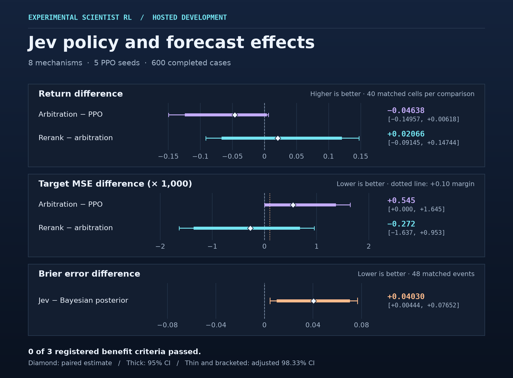
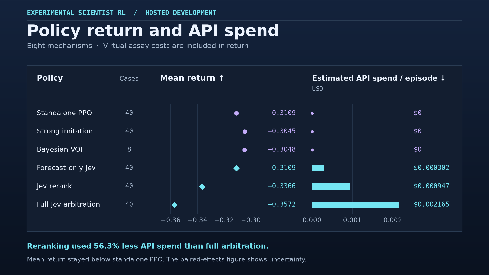
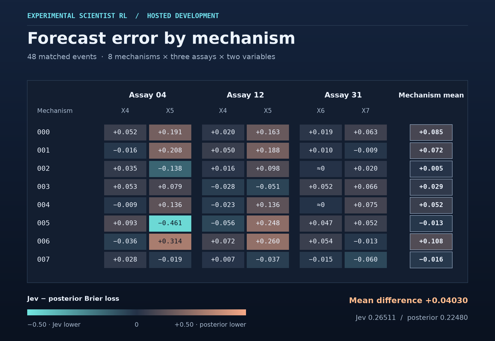

# When does a hosted decision model help an experimental policy?

**A paired development study of Jev and PPO on synthetic systems · November 14, 2026**

We tested whether a typed decision model improves a learned policy that buys measurements under a fixed budget. The study compared full Jev arbitration, reranking a small set of PPO proposals, and forecasts that leave the policy in control. All 600 planned cases completed across eight mechanisms and five PPO seeds. All three registered benefit gates failed. The narrower reranker used 56.3% less estimated API spend than full arbitration. Its mean return was higher than arbitration’s, with a wide interval spanning zero, and lower than standalone PPO’s. Jev’s fixed-probe Brier error exceeded the Bayesian posterior by 0.04030 across 48 matched events, with an adjusted 98.333% interval of [+0.00444, +0.07652]. [Complete paired analysis](../reports/jev-rl-m2/hosted-analysis-01/REPORT.md)

[Replay from a clone](m2-reproduction.md) · [Sealed run](../reports/jev-rl-m2/hosted-study-01) · [Per-case evidence](../reports/jev-rl-m2/hosted-study-01/episodes) · [Policy card](m2-policy-card.md) · [Evidence card](m2-evidence-card.md)

## Question and design

A learned experimental policy can decide what to buy, when to stop, and what final action to select. A decision model can alter the action, suggest a choice within the policy’s proposals, or forecast an impending measurement. These are different interventions. A forecast can improve without changing a decision, and a cheaper hosted controller can still lose control utility.

The task has 36 assay actions and nine final actions. Each episode buys up to four assays with eight virtual cost units. The initial measurement has a common setup cost of three units. The evaluator scores a final action on 128 fresh simulator samples, and the original return is `−100 × target MSE − 0.01 × variable assay cost − 0.05 × effort`. The policy and hosted component receive public observations only. The simulator retains the realized mechanism and evaluation randomness. [Scientific protocol](protocol.md) · [Frozen hosted plan](../reports/jev-rl-m2/hosted-study-01/plan.json)

| Role | What the controller can change | Comparison |
|---|---|---|
| PPO and v6 PPO | Full legal decision using the frozen learned policy | Standalone learned comparators |
| Full Jev arbitration | Chooses from the full legal set with PPO advice and prospective forecasts | Standalone PPO, and hidden, chance and public-forecast controls |
| Rerank | Chooses among three legal PPO proposals, including the highest-probability commitment | Full arbitration and a shadow that buys the same kind of advice but follows PPO |
| Forecast only | Estimates selected assay outcomes after PPO has chosen and before measurement | Identical PPO policy outcomes and separate forecast/call accounting |
| Jev only | Selects from the full legal set without PPO advice | PPO, fixed design, imitation and Bayesian planning |
| Fixed probe | Runs three prespecified assays with two forecast events each | Same-event Brier error for Jev, Bayesian posterior, prior, chance and a public heuristic |

The hidden, chance and public-forecast controls retain the required forecast requests and change which forecast values are visible at commitment. As actions diverge, the number of calls and later observations can also differ. The unchanged M1 arbitration prompt and v6 checkpoint serve as an additional historical incumbent. [Role and failure definitions](jev_rl_m2_hosted_protocol.md)

## What was fixed before evaluation

| Registration | Evidence fixed |
|---|---|
| Before PPO training | Resource caps, model and update grid, selection rules, and development splits. [Protocol commit](https://github.com/Vajraaaang/experimental-scientist-rl/commit/9043afc0721f5613c0c13c607e7189751cc08e81) |
| Before confirmation | Thirty-five checkpoint identities. [Checkpoint freeze](https://github.com/Vajraaaang/experimental-scientist-rl/commit/cdda216e319f63beda8a09bdc1d8f9af9916c20f) |
| Before hosted evaluation | Plan and analyzer hashes, paired outcomes, thresholds, and interval method. [Analysis registration](https://github.com/Vajraaaang/experimental-scientist-rl/blob/5145460218f7a7e071f87ca259804d1d0fc3bf98/docs/jev_rl_m2_analysis_registration.json) |

All learned role comparisons use matched seed–mechanism cells. Seed-independent baselines use one observation per mechanism. The paired bootstrap resamples training seeds and mechanisms independently for return and MSE, and resamples full six-event mechanism clusters for the Brier contrast. We use 10,000 draws and report paired 95% intervals and three-family Bonferroni-adjusted 98.333% intervals. The registered return gate requires a positive adjusted lower bound and an adjusted upper MSE change of at most 0.0001. The forecast gate requires complete coverage and a negative adjusted Brier change upper bound. [Analysis contract](jev_rl_m2_analysis_registration.json) · [Raw per-case records](../reports/jev-rl-m2/hosted-study-01/episodes)

## Results

Return and MSE contrasts use 40 matched seed–mechanism cells each. The Brier contrast uses 48 events clustered into eight mechanisms. The MSE panel multiplies values by 1,000. [Figure values](../reports/jev-rl-m2/figures/figure-data.json)

| Registered contrast | Effect | Paired 95% interval | Adjusted 98.333% interval | Benefit gate |
|---|---:|---:|---:|---|
| Full arbitration minus PPO, return | −0.04638 | [−0.12441, +0.00380] | [−0.14957, +0.00618] | Failed |
| Full arbitration minus PPO, target MSE | +0.000545 | [0, +0.001368] | [0, +0.001645] | |
| Rerank minus full arbitration, return | +0.02066 | [−0.06703, +0.12078] | [−0.09145, +0.14744] | Failed |
| Rerank minus full arbitration, target MSE | −0.000272 | [−0.001357, +0.000682] | [−0.001637, +0.000953] | |
| Fixed probe, Jev minus posterior Brier | +0.04030 | [+0.01002, +0.07051] | [+0.00444, +0.07652] | Failed |

| Method | Episodes | Mean return ↑ | Target MSE ↓ | Variable assay cost ↓ | Hosted calls | Estimated API cost, total |
|---|---:|---:|---:|---:|---:|---:|
| Strong imitation | 40 | −0.30453 | 0.002308 | 4.3775 | 0 | $0 |
| Bayesian VOI | 8 | −0.30475 | 0.002308 | 4.4000 | 0 | $0 |
| Frozen v6 PPO | 40 | −0.30950 | 0.002308 | 4.8750 | 0 | $0 |
| Selected PPO | 40 | −0.31085 | 0.002308 | 5.0100 | 0 | $0 |
| PPO with forecast-only Jev | 40 | −0.31085 | 0.002308 | 5.0100 | 83 | $0.01209 |
| Rerank shadow | 40 | −0.31085 | 0.002308 | 5.0100 | 206 | $0.03752 |
| Jev rerank | 40 | −0.33658 | 0.002581 | 5.0525 | 208 | $0.03788 |
| Full Jev arbitration | 40 | −0.35724 | 0.002852 | 4.6025 | 219 | $0.08660 |
| Jev arbitration, public proxy | 40 | −0.39109 | 0.003263 | 4.1750 | 205 | $0.08132 |
| Jev arbitration, chance forecast | 40 | −0.40423 | 0.003399 | 4.2375 | 204 | $0.07980 |
| Jev arbitration, hidden forecast | 40 | −0.43981 | 0.003724 | 4.6425 | 212 | $0.07660 |
| Strong fixed schedule | 8 | −0.45137 | 0.003674 | 6.4000 | 0 | $0 |
| M1 incumbent | 40 | −0.51906 | 0.004594 | 4.0650 | 196 | $0.05564 |
| Jev only | 8 | −0.66250 | 0.006400 | 2.2500 | 29 | $0.01051 |

The complete table includes 23 methods and all 600 cases. API dollars measure input-token spend and are separate from the virtual assay units in the reward. [Complete paired analysis](../reports/jev-rl-m2/hosted-analysis-01/REPORT.md)

The spend comparison uses 40 episodes per Jev-assisted policy. Bayesian VOI runs once per mechanism, for eight episodes. The plot shows mean return and estimated input-token dollars per episode.

### Where the policies differed

- Forecast-only and rerank shadow reproduced all 40 PPO action sequences. Reranking changed four sequences and two final decisions. It improved return in two cells and reduced return in two. Its mean return was 0.02572 lower than the shadow, with a descriptive 95% interval of [−0.08896, +0.00015].
- Full arbitration had higher point returns than all three forecast controls. All three descriptive paired 95% intervals crossed zero. Its mean return trailed standalone PPO and strong imitation.
- On the fixed probe, Jev scored 0.26511, the Bayesian posterior scored 0.22480, and the prior scored 0.22488. Chance was 0.25000. All 48 forecasts were scored. Jev’s Brier difference versus posterior favored Jev on two of the eight mechanism clusters. All 48 Jev probabilities fell in two fixed bins, [0.4, 0.5) and [0.5, 0.6). This is a descriptive reliability check with eight clusters.
- Forty-case mean reset-inclusive time was 0.011 s for PPO, 0.573 s for forecast-only, 1.528 s for rerank and 1.869 s for arbitration. Recorded time includes reference computation and synchronous journals along with the relevant model calls. Three of eight Jev-only cases committed immediately. Detailed stop, latency and coverage counts are available per role.

Each cell is Jev minus posterior Brier loss for the same measured event. Negative values favor Jev. Positive values favor the posterior.

The study used 1,586 successful calls to `jev-1.14.0`, 1,586 distinct provider request IDs, 11,466,303 input tokens and 952,218 output tokens. Estimated input spend was $0.481585 at $0.042 per million tokens. The dispatch and evaluation loop took 561.79 seconds, including 387.15 seconds in recorded API transport. There were zero failed or skipped cases. [Analysis summary](../reports/jev-rl-m2/hosted-analysis-01/summary.json) · [Forecast bins and usage receipts](../reports/jev-rl-m2/hosted-study-01/results.json) · [TypeSafe pricing](https://help.typesafe.ai/articles/5187202169-how-much-does-jev-cost)

## PPO and compute

The PPO study completed 42 runs and 49.65 million training transitions in 49.4 minutes. GRU128 led the two-seed screen at 240 seconds. GRU512 led at approximately two million interactions. The selected continuation used batch 512, learning rate 0.0003, and two update epochs. On 128 fresh development mechanisms, selected PPO minus v6 return was +0.00630, with a paired 95% interval of [−0.00170, +0.02062]. [Compute budgets and PPO results](../reports/jev-rl-m2/REPORT.md) · [Equal-time and equal-interaction tables](../reports/jev-rl-m2/summary-01/COMPARISONS.md)

## Limits and reuse

Eight mechanism clusters give a narrow view of Jev’s behavior. One mechanism also served in the engineering fixture, and all belong to familiar simulator families. The learned-method contrasts cover five trained seeds, and the forecast comparison covers 48 dependent events. The Bayesian posterior is a strong reference built from the simulator family. The Brier score measures probability accuracy, and the two occupied bins limit what the data say about calibration. The hosted study records one pinned service version and one run, so repeated-response behavior and performance on changed mechanisms require new evidence. The policy-size difference between selected PPO and historical imitation also limits claims about PPO as an algorithm.

The evaluated systems are abstract and synthetic. The next final split remains unopened after the development gates failed. The public artifact supports independent replay of the recorded experiment and estimates. Inference with the original checkpoints, fresh provider responses and training reproduction are separate levels of verification. The repository currently has no explicit reuse license. [Reproduction guide](m2-reproduction.md) · [Policy card](m2-policy-card.md) · [Evidence card](m2-evidence-card.md)

See the related work and the study decisions it informed. [Sources and design rationale](jev_rl_m2_sources_and_design.md)
