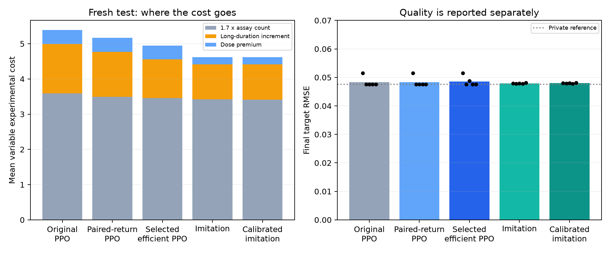

# PPO experimental-cost efficiency follow-up

Experimental cost fell 8.20% on the new locked test. The quality noninferiority screen passed, but net-return improvement remains uncertain; the selected method does not pass the full frozen efficiency screen. Lower expenditure alone is not called an overall win.

## Another fresh locked comparison

Five retained seeds, 2,048 new parameterized mechanisms from generator seed 57401, original unfiltered task physics,budget 8, prices, reward and reference scoring. No method was tuned after this test. All original fixed and learned baselines remain unchanged.

| Method | Final RMSE | Variable cost | Mean return | Success within 0.04 |
|---|---:|---:|---:|---:|
|prior|0.08000|0.000|-0.64000|0.00%|
|fixed|0.05439|6.400|-0.38508|62.89%|
|fixed quality|0.05431|7.400|-0.39424|63.09%|
|additive|0.06071|5.800|-0.44778|50.20%|
|random|0.06815|7.157|-0.55329|27.83%|
|bo|0.06109|5.103|-0.44378|48.73%|
|eig|0.05437|7.700|-0.39779|62.94%|
|voi|0.04763|4.644|-0.30349|75.49%|
|original ppo|0.04836|5.391|-0.31728|71.80%|
|efficient ppo|0.04860|4.949|-0.31501|71.38%|
|paired ppo|0.04835|5.170|-0.31497|71.82%|
|imitation|0.04790|4.622|-0.30582|75.25%|
|calibrated imitation|0.04796|4.614|-0.30632|75.25%|
|imitation ppo|0.04776|4.637|-0.30468|75.36%|
|private nominal reference (privileged)|0.04752|0.000|-0.25608|75.68%|

Versus original PPO, the selected policy reduces cost by 0.442197 (95% CI [0.286093, 0.60759]), or 8.20% at the point estimate. Raw MSE increase is 2.31438e-05 (95% CI [-3.30562e-06, 7.53213e-05]); return improvement is 0.00227165 (95% CI [-0.00136561, 0.00484469]).

The predeclared noninferiority screen uses an upper two-sided 95% bound on MSE increase of 0.0001. This is an engineering margin, not proof of identical quality or a universal scientific criterion. The full efficiency screen additionally requires positive cost and return intervals.

Versus equally calibrated imitation: cost reduction -0.335117 (95% CI [-0.496842, -0.204983]); MSE increase 6.19741e-05 (95% CI [-4.19323e-05, 0.00020791]); return improvement -0.0086892 (95% CI [-0.0211987, 0.000744894]). Both unchanged imitation and its public-price-calibrated version are retained so the PPO comparison does not weaken the baseline.

## What made PPO expensive

New development traces found a mean PPO-minus-imitation cost gap of 0.682. Its exact additive decomposition was: extra assay-count baseline 0.090; long-duration increment 0.393; higher-dose premium 0.199. Each assay costs 1.7 at duration 1 before dose; duration 6 adds exactly 1.0; both panels contain two variables and have the same price.

Imitation consistently used one long outcome assay and short proxy follow-ups. Several PPO seeds substituted additional long outcome assays; higher doses and extra queries contributed too. Panel identity alone did not change price. Exact action/duration/dose/control histories, stopping and repeat counts were collected on development mechanisms only.

The previous curriculum and high early entropy were plausible sources of the habit, but not assumed proven causes. Matched low/zero-entropy continuation and temporary cheaper-follow-up exposure produced limited improvements in bounded controls. All scientific fees and penalties remained fixed.

## The selected method and what it means

Development selected `paired_training_calibrated`: model source `trained`, with common public calibration coefficients {'duration_penalty': 4.0, 'dose_penalty': 4.0, 'stop_bonus': 0.5}. The identical coordinate search was offered to imitation; its selected coefficients are {'duration_penalty': 0.0, 'dose_penalty': 16.0, 'stop_bonus': 0.1}.

Calibration changes logits using only declared duration,dose prices and public experiment count. It never changes legal masks,measured values, target error or reward. Duration penalties and stop bonuses apply after the first assay; dose prices apply to experiments. It is transparent post-processing, not a PPO gradient discovery or an oracle action ranking. The GRU64 architecture and learned parameter count stay unchanged.

The additional training variant used four independently seeded deployments of the same training mechanism/goal. Actor coefficients were each observed full return minus the mean of the other three returns; critic targets remained ordinary complete Monte Carlo returns. No group identity, mechanism parameters,unbought evidence or counterfactual action labels entered the policy. PPO clipping remains approximate,so this is a declared variance-reduction variant rather than a claim of unbiased PPO.

Independent review caught an unintended transition-weighted centering step in the initial paired pilot. With unequal episode lengths,it changed the declared leave-one-out coefficients. An integration regression failed,then passed after centering was disabled for this variant. The initial centered pilots are retained but excluded from promotion. Old v3/v4 PPO results are unaffected.

Candidate selection used 256 tuning mechanisms and a separate 256-mechanism development confirmation slice. Confirmation aggregates were inspected and are treated as development evidence. The final wrappers, checkpoint hashes,baseline schedules, quality margin and test generation were frozen before the new test. All five seeds were retained.

Using the common final selector on the efficient policy's purchased assays gives aggregate RMSE 0.04774,compared with its learned commitment RMSE 0.04860. This separates experiment selection from evidence interpretation; replay timing is not a full-policy latency comparison.

## Compute,preservation and limits

The new five-seed continuation consumed 5,000,839 physical interactions and 5,000,839 sampled policy decisions. Summed training/validation wall time across parallel jobs was 671.5s. Bounded pilots consumed another 3,801,961 interactions,including retained failed/centered controls. Calibration/evaluation costs are separate from those gradient interaction counts.

No larger network,GPU migration,new task family or altered reward prices was introduced. The existing CPU path and exact private simulator cache were reused. Final scoring used the original uncached reference dynamics; single/batched greedy development actions and scores were checked identical before locking.

The exhaustive 10,373-design fixed and quality-focused schedules,prior,random,additive identification,BO,EIG,VOI,and stronger imitation remain in the test. Fixed/random/BO/EIG/VOI use the same public-history final estimator. The common baseline setup costs 3 outside the variable budget. The reference has privileged mechanism access and zero variable assay cost.

The primary comparison is greedy deployment; stochastic checks are retained in the raw result. Confidence intervals cross training seeds and paired mechanisms. The task remains a familiar-motif continuous-parameter holdout with culture-offset SD zero. Broader structures, ranges, culture variation and real biology are not qualified.

Previous locked studies,protected models and baseline schedules are verified byte-for-byte unchanged. Source/checkpoint hashes,raw rows,traces, negative candidates and selection rules are included. No result from this fresh test was used to retune a method.

The leave-one-out formula is adapted from [the RLOO method](https://arxiv.org/abs/2402.14740) and its [public implementation documentation](https://github.com/huggingface/trl/blob/main/docs/source/rloo_trainer.md); this project uses trajectory returns in a small scientific simulator, not an LLM training reproduction.

Publication note: recorded protocols, numerical rows, curves and hashes are included here. Checkpoint/demonstration binaries and source archives remain in the local research deliverable and are excluded from Git. Original hashes refer to the development artifacts before machine-path redaction and publication portability edits.
