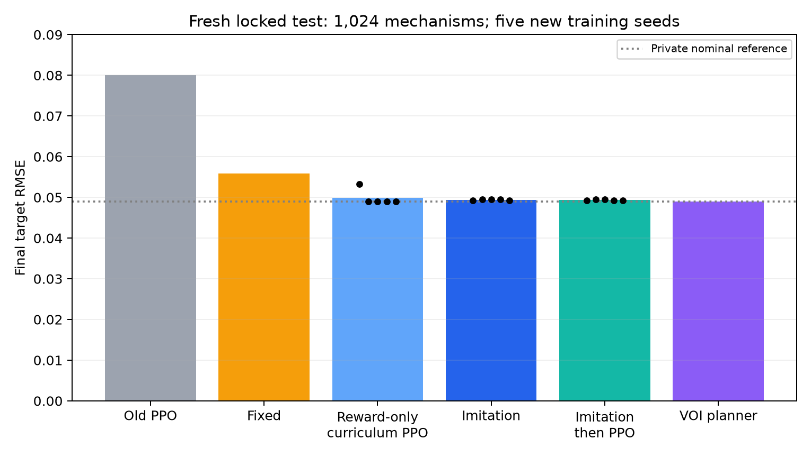
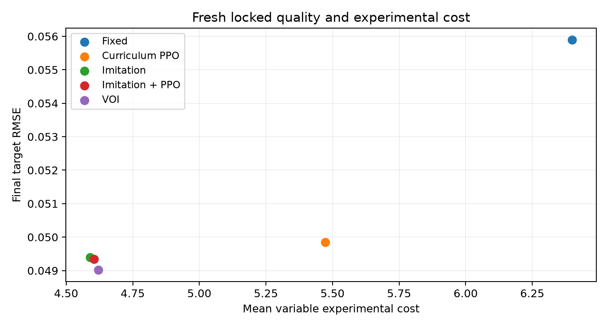
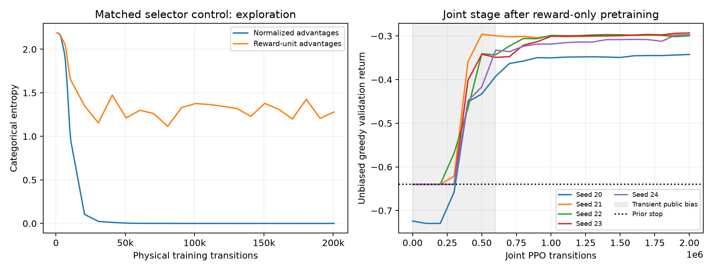

# PPO collapse follow-up: measured report

**Outcome:** collapse is avoided with a reward-only experimental curriculum and more training. The strengthened PPO beats the preserved exhaustive fixed baseline on a fresh locked test, but imitation remains more cost-effective. Additional PPO after imitation still has no established benefit.

## Fresh frozen comparison

Five independently initialized training seeds (20–24), 1,024 fresh mechanisms from generator seed 27401, unchanged unfiltered task physics/costs/actions, and uncached reference scoring. New mechanisms are hash-disjoint from training, validation and the previous test. All seeds are retained. Checkpoints are selected on development return before scoring.

| Method | Final RMSE | Variable cost | Mean return | Success within 0.04 |
|---|---:|---:|---:|---:|
| prior | 0.08000 | 0.000 | -0.64000 | 0.00% |
| fixed | 0.05590 | 6.400 | -0.40038 | 59.77% |
| fixed quality | 0.05580 | 7.400 | -0.40941 | 59.96% |
| additive | 0.06121 | 5.800 | -0.45313 | 48.93% |
| random | 0.07022 | 7.162 | -0.58124 | 24.02% |
| bo | 0.06267 | 5.171 | -0.46255 | 45.12% |
| eig | 0.05515 | 7.695 | -0.40567 | 61.33% |
| voi | 0.04902 | 4.621 | -0.31567 | 72.95% |
| legacy ppo | 0.08000 | 0.000 | -0.64000 | 0.00% |
| legacy imitation | 0.05001 | 4.600 | -0.32519 | 71.84% |
| curriculum ppo | 0.04985 | 5.473 | -0.33161 | 68.79% |
| imitation | 0.04940 | 4.590 | -0.31904 | 72.48% |
| imitation ppo | 0.04935 | 4.604 | -0.31869 | 72.54% |
| private nominal reference (privileged) | 0.04896 | 0.000 | -0.26897 | 73.05% |

All methods receive the setup baseline assay; its fixed cost 3 is outside the variable budget. The reference knows the mechanism and has privileged zero variable assay cost. Unreachable targets remain included. Primary quality is mean target MSE; tables display its aggregate square root. Cost and return are separately reported.

Reward-only curriculum PPO improves return over exhaustive fixed by 0.06877, hierarchical 95% CI [0.05166, 0.08358]. Its paired raw MSE reduction is 0.000639208 (95% CI [0.00042899, 0.000809568]). Its cost reduction is 0.927363 (95% CI [0.678864, 1.19298]).

Against strengthened imitation, curriculum PPO changes return by -0.01257, CI [-0.02770, -0.00267]. It spends 0.883 more cost units on average. Raw-quality difference is not clearly established: MSE reduction -4.51422e-05 (95% CI [-0.000232921, 6.65762e-05]).

Imitation followed by another million PPO transitions per seed changes return by 0.000347, CI [-0.000784, 0.001779]. Its raw MSE reduction interval also includes zero: 4.93639e-06 (95% CI [-6.38125e-06, 2.0268e-05]). This does not establish PPO-specific added value over strong imitation.

Intervals resample both training seeds and paired mechanisms. Five seeds remain a limited sample of optimization randomness. No method was retuned after these results were opened.

The stochastic-policy secondary check has mean returns -0.34652 for curriculum PPO, -0.32304 for imitation and -0.32172 for imitation+PPO. The main ordering is therefore not an artifact of greedy deployment. These are descriptive secondary estimates; primary intervals above concern the frozen greedy protocol.

## Why the old PPO collapsed

No concrete reward-sign, recurrent-reset, padding, probability-ratio or GAE bug explained the collapse. Independent review and focused numerical tests found those paths consistent. The dominant issue was a learning cold start: experiments help only after final intervention choices can interpret them. Before that skill exists, assays add certain cost.

Under the declared prior, no intervention has expected terminal return -0.6400; dose 0.4 interventions average about -0.72490, dose 0.8 about -0.92834, and uniform commitment about -0.80589. If final choices ignore evidence, buying an assay does not improve those expectations. The initial policy therefore receives a real gradient toward stopping.

Old entropy fell from about 3.5 to 0.006–0.023 by 10k transitions; reset probabilities of buying evidence fell to roughly 0.000005–0.0033. Extending a nearly deterministic stop policy supplies almost no informative data.

A second amplifier was entropy scaling. With per-batch advantage normalization, the fixed entropy coefficient acts roughly like coefficient times advantage SD in return units. As the stop policy/critic reduce variance, that effective exploration pressure shrinks. In a matched fixed-assay control, removing advantage normalization preserves entropy around 1.3 rather than near zero, but 200k transitions were still insufficient to learn the final interpretation.

One million raw-advantage selector transitions did learn: return -0.4848 versus -0.6875 for choosing none after the same public assays; a shared posterior selector on those assays reaches -0.4636. The early 200k curriculum had released the joint problem before this competence developed. A paired single-assay/two-choice control also learned; its initial mixed-schedule evaluation was corrected to the proper matched control before protocol selection.

Larger batches or stronger entropy alone did not solve the task in the bounded screens. A one-million-transition joint raw-advantage run still greedily stopped. Learning interpretation first, then gradually releasing assay selection, provided a successful route. Critic weighting may affect stability, but both tested weights recovered, so it was not established as the sole cause.

## Stronger training, with the scientific task held fixed

The 64-unit GRU actor–critic remains unchanged (32,814 parameters). The reward-only PPO arm uses no planner action labels. It first buys randomized public fixed designs and learns only terminal intervention choices from real terminal rewards. Forced assay positions are excluded from actor/entropy losses, while their public histories remain differentiable and their physical costs remain charged.

Selector training has a one-million-transition minimum, a two-million cap and a development competence threshold of -0.51. All five seeds graduated at about one million. The following two-million-transition joint phase uses stored, public exploration biases that are included in both old and new probabilities. The biases disappear after the first 30%; checkpoints are eligible only after at least one million joint transitions. Final evaluation restores the original masks and uses zero training bias.

Advantages remain in reward units; complete-episode MC returns use gamma 1 and GAE lambda 1. PPO uses clipping, gradient clipping, post-update nonnegative approximate KL, a KL stopping guard, advantage/entropy/value diagnostics and early actor-versus-critic gradient audits. Separate phase seed namespaces ensure new observation draws between phases.

The strengthened imitation baseline uses 2,048 public-history VOI demonstrations and 12,000 whole-episode minibatch updates, with only mathematically ancillary baseline/within-cohort-SD augmentation. The same GRU architecture is used. Fine-tuning freezes the policy for 500 critic-head warmup updates before another million PPO transitions. All checkpoint selection uses the same development mechanisms and never the new test.

The exhaustive fixed and quality-focused schedules remain byte-for-byte preserved from the 10,373-design/512-calibration search. Prior, random, additive single-control identification, direct-assay BO, EIG and VOI remain in the fresh comparison. The additive subset is tuned on calibration only. Fixed/random/BO/EIG/VOI share the same final estimator; additive and fully learned commitments are distinguished.

Replaying curriculum PPO's assays with the common final selector gives RMSE 0.04896, versus fully learned 0.04985. For imitation the corresponding figures are 0.04921 and 0.04940. These are interpretation ablations; replay timing is not a full-policy latency measurement.

## Compute and the 30-core GPU

The main comparison consumed 20,002,755 physical interactions: 15,001,648 for reward-only selector/joint PPO and 5,001,107 for imitation fine-tuning. 16,669,040 were sampled policy decisions; forced public assay positions are counted in physical interactions but not actor updates. Development controls used another 5,492,836 interactions.

Summed main PPO training/validation wall time is 3164.9s across parallel processes, not elapsed wall time. Imitation training/validation totals 275.8s; critic warmup totals 27.3s. The shared teacher cost 122.5s for 2,048 episodes and 6,145 public-history decisions, paid once for the shared dataset. Actual per-seed counts and selected checkpoints are in summary.json.

Actual hardware inspection confirms an M3 Max with 30 GPU cores, 14 CPU cores and 36 GiB unified RAM, macOS 26.3.1(a), native arm64 Python 3.12.1 and PyTorch 2.14.1. Scientific reference calculations stay NumPy/SciPy float64 on CPU; neural models use float32. Native MPS works with fallback disabled.

Compute rework was limited to measured bottlenecks. An evaluator-owned zero-offset endpoint cache preserves every checked observation/reward exactly (maximum error 0.0), fresh noise and RNG consumption; unsupported settings use the original simulator. It gives about 9.25x rollout speedup. Policies never receive its hidden endpoints. The locked comparison uses the original uncached simulator.

Host-padded one-transfer-per-field packing and batch-vectorized GAE preserve fields/returns exactly in the checked CPU/MPS cases. A separate optimizer-step test preserves the result within float32 tolerance. These are optional performance paths; no larger architecture or changed scientific problem was introduced.

At the actual 128-episode workload, the original measured CPU/MPS rates were 6795/588 transitions/s. Tensorization raised the measured MPS rate to 2162; CPU remained faster at 5614. The latter benchmark shared the machine with imitation training. All main scientific runs therefore used CPU.

The GPU can help larger dense batches: a preloaded 4,096-episode GRU microstep measured about 5.1ms on MPS versus 46.0ms on one contended CPU thread. Including synthetic host packing/GAE gave about 67.1ms versus 103.4ms. Those microbenchmarks exclude real rollout/PPO overhead and do not justify enlarging the current model solely to use GPU cores. Higher-compute rework stops here unless a later measured need appears.

## Scope, preservation and validation

The new test has 1,024 fresh continuous mechanisms within familiar motif support, no feasibility conditioning, budget 8 and culture-offset SD zero. Structural, range-shift, culture-variation and real-biology transfer remain unqualified. Greedy policy deployment is primary; stochastic rollout results are recorded separately in summary.json and the raw locked file.

The previous v3 locked results, 15 protected checkpoints, baseline schedules and original deliverable remain unchanged. Fresh protocol/checkpoint hashes were frozen before scoring, and source/checkpoint integrity is checked after evaluation. No difficult seed was removed and no fresh result selected a model or hyperparameter.

Fresh full-suite and native-device evidence is recorded in reports/ppo-v4/validation.json. Source snapshots, configs, training curves, selected checkpoints, demonstration data and raw paired rows are included. The old report remains a historical result; this follow-up report supersedes its conclusion that reward-only PPO could only stop.

Implementation references: [OpenAI Spinning Up PPO](https://spinningup.openai.com/en/latest/algorithms/ppo.html) and [Stable Baselines3 PPO source](https://stable-baselines3.readthedocs.io/en/v2.7.1/_modules/stable_baselines3/ppo/ppo.html). These support the algorithmic controls; the simulator and measured conclusions are this project's experiments.

Publication note: recorded protocols, numerical rows, curves and hashes are included here. Checkpoint/demonstration binaries and source archives remain in the local research deliverable and are excluded from Git. Original hashes refer to the development artifacts before machine-path redaction and publication portability edits.
