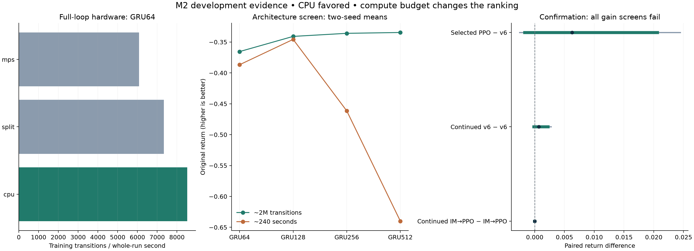

# PPO configuration and hosted Jev evaluation

This report covers the bounded PPO configuration study, five-seed confirmation, and paired hosted Jev comparison. [Research note](../../docs/m2-research-note.md)

CPU was the fastest measured backend for this complete PPO workload. The bounded
42-run search selected a scratch-trained GRU512 with batch 512, learning rate 0.0003
and two update epochs. Five-seed confirmation did **not** establish a return gain
over v6, and strong imitation and the Bayesian VOI planner remained cheaper with
higher mean return. The Jev client, three distinct Jev roles, matched controls,
failure accounting and credential-free replay are implemented. Their larger hosted
comparison completed 600 cases with 1,586 successful Jev calls. The three hosted
benefit gates failed. The new final split remains unopened.

## Study registration

The [task-derived protocol](../../docs/jev_rl_m2_protocol.md) and
[source-to-design rationale](../../docs/jev_rl_m2_sources_and_design.md) were published
before registered training in commit
[`9043afc`](https://github.com/Vajraaaang/experimental-scientist-rl/commit/9043afc0721f5613c0c13c607e7189751cc08e81).
The selected 35-checkpoint confirmation freeze was published in commit
[`cdda216`](https://github.com/Vajraaaang/experimental-scientist-rl/commit/cdda216)
before generating confirmation mechanisms. Selection used tuning generator 991311;
confirmation used 991321. Final generator 991401 was not opened. No PPO tuning was
performed after confirmation results were observed.

## Hardware and finite compute

The profiler measures environment reset/rollout, tensor packing and transfers,
advantages, PPO updates, validation and checkpoint round trips. Native MPS and
CPU-rollout/MPS-update were actually exercised, with no implicit device fallback.
The split implementation keeps learner/Adam state on MPS and synchronizes a CPU
policy mirror. Action masks, forced-policy positions, old log probabilities,
optimizer ownership and cached/reference simulator agreement are checked.

| Backend, GRU64/batch 1024 | Training transitions/cycle-second | Training transitions/whole-run-second | Sustained run |
|---|---:|---:|---:|
| CPU | 8,603.65 | 8,522.06 | 60.09 s |
| MPS | 6,137.59 | 6,080.59 | 60.54 s |
| CPU rollout / MPS update | 7,410.92 | 7,342.97 | 60.14 s |

Whole-run timing includes setup and finalization; cycle timing does not. CPU also
won the short history/GRU capacity probes through 512 units. Four single-threaded
CPU seed workers were selected for the race. Their profiling group stopped at its
transition cap after approximately 28 seconds, so it is not a full 45-second sustained
concurrency result. Summed per-process rates are not group wall-clock throughput.

| Work | Declared cap | Observed |
|---|---|---|
| Profiling, including resource-only selected-model probe | 3,000,000 simulator steps; bounded profiling windows | 2,998,784 steps |
| Registered race | 60,000,000 training transitions; 3,600 s active orchestration; 2,000,000 validation transitions | 49,652,308 training; 166,142 validation; 2,963.51 s (49.4 min) |
| Fresh development confirmation | 128 mechanisms, all five seeds; 600 s | 5,632 episodes; 16,814 step calls; 38.47 s including finalization; zero errors |

Engineering fixtures, unit tests and replay are separate from training counts.
Inherited v6/imitation pretraining is recorded separately and is not treated as
new training or equal-compute evidence.

Sustained CPU throughput fell 0.31% between the two halves of the run. The last
approximately 126 seconds of the race had a nominal OS thermal state and a sampled
aggregate training-process RSS peak of 2.18 GiB. A separate short resource probe
measured 0.583 GiB peak process RSS. These measurements cover the sampled processes
and intervals. [Resource measurements](resource-summary.json)

## Capacity, recipes and budget-dependent rankings

History and recurrent policies at 64/128/256/512 units were screened on seeds 20/21
with approximately 1 M public-selector and 1 M joint interactions. Four batch/update
recipes then continued the selected architecture. The selected scratch and v6
continuations retained all five seeds 20–24; imitation→PPO continuation stayed a
separate cohort. All 42 jobs completed correctly with valid primary snapshots.

The [generated tables](summary-01/COMPARISONS.md) show every two-seed architecture,
recipe and v6 screen at equal interaction and equal wall budgets, including phase,
actual transitions and elapsed time. At approximately 2 M interactions, GRU512 had
the best two-seed endpoint mean return (−0.334584). At 240 seconds, GRU128 led
(−0.345770); GRU512 was still in its selector curriculum and its unforced policy
stopped immediately (−0.640000). Thus 512 is not best at every wall budget.

Recipe wall comparisons are 70-second **continuations** from common trained parents
for each seed. They exclude inherited pretraining time. The frozen selection rule
can choose an eligible intermediate checkpoint; endpoint tables do not silently
substitute that selected checkpoint. The race is a finite screen, not an exhaustive
search over PPO architectures or all possible training recipes.

## Five-seed confirmation and null result

All learned methods used the same 128 confirmation mechanisms and five retained
seeds. Seed-independent planners were evaluated once per mechanism; tiling for
pairing did not invent replicates. The separate privileged reference knows the
mechanism and has no assay cost, so it is not an attainable comparator.

| Method | Mean target MSE ↓ | Variable assay cost ↓ | Original return ↑ |
|---|---:|---:|---:|
| Selected scratch PPO, GRU512 | 0.00219028 | 4.86156 | −0.298268 |
| Original v6 PPO, GRU64 | 0.00226115 | 4.85125 | −0.304565 |
| Continued v6 PPO | 0.00226115 | 4.78188 | −0.303871 |
| Strong imitation, GRU64 | 0.00220615 | 4.54719 | −0.296775 |
| Calibrated imitation | 0.00220615 | 4.54625 | −0.296765 |
| Imitation→PPO | 0.00220615 | 4.56109 | −0.296914 |
| Continued imitation→PPO | 0.00220615 | 4.56234 | −0.296926 |
| Bayesian VOI | 0.00219028 | 4.56406 | −0.295293 |
| Strong fixed design | 0.00276822 | 6.40000 | −0.367697 |

Selected PPO minus v6 return was+0.00629636, with paired 95% interval
[−0.00169871,+0.02061855] and multiplicity-adjusted 98.333% interval
[−0.00256719,+0.02444921]. Continued-v6 return gain was+0.00069375,95%
[−0.00017813,+0.00222656]. Continued-imitation→PPO return difference was−0.00001250,
95%[−0.00004219,+0.00000156]. **All three prespecified gain screens failed.**

Intervals use 10,000 paired crossed seed/mechanism bootstrap draws, RNG 991499.
GRU512 matched the privileged reference's MSE on this slice, while paying more
assay cost than VOI and imitation. Capacity and training history differ between
GRU512 PPO and GRU64 imitation; this does not isolate the value of PPO learning.
Familiar motifs and parameter ranges remain a generalization limitation. Do not
compare these absolute errors to the historical 4,096-mechanism v6 test as a gain:
the mechanism samples differ. The frozen scoring configuration is the same.

In the confirmation panel, thick intervals are 95% and thin intervals are 98.333%.
Screen means have only two training seeds and no inferential superiority claim.

## Hosted development results

The study compares full arbitration, forecast-only assistance, and reranking three
legal PPO proposals. It includes matched forecast controls, the rerank shadow,
standalone PPO, imitation, fixed designs, and Bayesian planning. Typed forecasts
are frozen before observation and linked to their call receipts and measurements.
[Hosted protocol](../../docs/jev_rl_m2_hosted_protocol.md) · [Trace schema and controls](../../docs/jev_capabilities_audit.md)

The full eight-mechanism study used all five PPO seeds and completed all 600 cases
with zero failed or skipped episodes. All 1,586 call receipts reported HTTP 200,
resolved model `jev-1.14.0`, and complete usage. The study used 11,466,303 input
tokens and 952,218 output tokens. Estimated input spend was $0.481585. The measured
run took 561.79 seconds before the final replay, with 387.15 seconds of API transport.

| Registered comparison | Effect | Adjusted 98.333% interval |
|---|---:|---:|
| Full arbitration minus PPO, return | −0.04638 | [−0.14957, +0.00618] |
| Rerank minus full arbitration, return | +0.02066 | [−0.09145, +0.14744] |
| Jev minus Bayesian posterior, Brier error | +0.04030 | [+0.00444, +0.07652] |

All three gates failed. Brier error was 0.26511 for Jev and 0.22480 for the
posterior across 48 matched events and eight mechanism clusters. Reranking used
$0.03788 estimated input spend versus $0.08660 for arbitration. Its mean return
was lower than standalone PPO's. Forecast-only Jev left all 40 PPO action sequences
unchanged. [All role results, MSE intervals, and spending](hosted-analysis-01/REPORT.md)

The preregistered limits were 2,800 calls, $1 estimated input cost, and a 1,200-second
dispatch window. All were met. The final split remains unopened after the
development benefit criteria failed. [Prospective analysis registration](../../docs/jev_rl_m2_analysis_registration.json) · [Public plan](hosted-study-01/plan.json)

## Reproduction

The public workflow regenerates the statistics and replays recorded simulator
outcomes without model weights or API access. Exact controller replay and
checkpoint inference have separate verification requirements.
[Reproduction guide](../../docs/m2-reproduction.md) · [Export receipt](publication-export.json)
