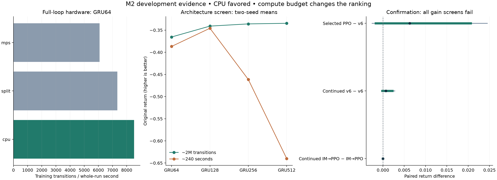

# M2 measured comparisons

Existing development evidence only; two-seed screen means have no uncertainty claim; no new selection or final evaluation.

All return values use the original reward; higher is better. Raw MSE and variable assay cost are lower-is-better. API dollars are a separate unit.

## Sustained full-loop hardware

| Backend | Training transitions / cycle second | Training transitions / whole-run second | Wall seconds |
|---|---:|---:|---:|
| cpu | 8603.65 | 8522.06 | 60.09 |
| mps | 6137.59 | 6080.59 | 60.54 |
| split | 7410.92 | 7342.97 | 60.14 |

## Architecture

Means over seeds 20 and 21 on the tuning split. Endpoint snapshots, not the best intermediate checkpoint. Continuation transitions exclude inherited pretraining.

| Configuration | Snapshot | Return | Raw MSE | Assay cost | New transitions | Elapsed seconds | Phase(s) |
|---|---|---:|---:|---:|---:|---:|---|
| arch-history-h128 | equal_interaction | -0.484406 | 0.00431886 | 3.7988 | 1999996.0 | 291.474 | joint, joint |
| arch-history-h128 | equal_wall | -0.490210 | 0.00431886 | 4.3793 | 1650114.0 | 240.092 | joint, joint |
| arch-history-h256 | equal_interaction | -0.444916 | 0.00386170 | 4.1090 | 1999995.5 | 313.922 | joint, joint |
| arch-history-h256 | equal_wall | -0.462418 | 0.00397160 | 4.8461 | 1505913.5 | 240.080 | joint, joint |
| arch-history-h512 | equal_interaction | -0.496074 | 0.00444660 | 3.7508 | 1999994.0 | 391.948 | joint, joint |
| arch-history-h512 | equal_wall | -0.620339 | 0.00610745 | 0.7484 | 1173684.0 | 240.100 | joint, joint |
| arch-history-h64 | equal_interaction | -0.531438 | 0.00485223 | 3.4965 | 1999995.5 | 282.136 | joint, joint |
| arch-history-h64 | equal_wall | -0.538460 | 0.00493667 | 3.4168 | 1713731.5 | 240.039 | joint, joint |
| arch-recurrent-h128 | equal_interaction | -0.340914 | 0.00256652 | 5.6293 | 1999996.5 | 300.568 | joint, joint |
| arch-recurrent-h128 | equal_wall | -0.345770 | 0.00260907 | 5.7207 | 1551265.5 | 240.080 | joint, joint |
| arch-recurrent-h256 | equal_interaction | -0.335929 | 0.00254526 | 5.3277 | 1999994.0 | 367.290 | joint, joint |
| arch-recurrent-h256 | equal_wall | -0.461468 | 0.00408714 | 3.5879 | 1200249.0 | 240.098 | joint, joint |
| arch-recurrent-h512 | equal_interaction | -0.334584 | 0.00255611 | 5.0691 | 1999995.0 | 561.961 | joint, joint |
| arch-recurrent-h512 | equal_wall | -0.640000 | 0.00640000 | 0.0000 | 706162.0 | 240.166 | selector, selector |
| arch-recurrent-h64 | equal_interaction | -0.365507 | 0.00282066 | 5.7895 | 1999995.0 | 275.771 | joint, joint |
| arch-recurrent-h64 | equal_wall | -0.386816 | 0.00300953 | 6.0160 | 1717699.5 | 240.055 | joint, joint |

## Updates

Means over seeds 20 and 21 on the tuning split. Endpoint snapshots, not the best intermediate checkpoint. Continuation transitions exclude inherited pretraining.

| Configuration | Snapshot | Return | Raw MSE | Assay cost | New transitions | Elapsed seconds | Phase(s) |
|---|---|---:|---:|---:|---:|---:|---|
| update-b1024-lr0.0001-e4 | equal_interaction | -0.332011 | 0.00254526 | 4.9359 | 499997.0 | 173.784 | joint, joint |
| update-b1024-lr0.0001-e4 | equal_wall | -0.332511 | 0.00254526 | 4.9859 | 178506.5 | 70.156 | joint, joint |
| update-b128-lr0.0003-e2 | equal_interaction | -0.336464 | 0.00258159 | 5.0023 | 499996.5 | 132.869 | joint, joint |
| update-b128-lr0.0003-e2 | equal_wall | -0.332925 | 0.00254526 | 5.0273 | 270419.0 | 70.034 | joint, joint |
| update-b256-lr0.0003-e2 | equal_interaction | -0.332593 | 0.00254526 | 4.9941 | 499996.5 | 153.108 | joint, joint |
| update-b256-lr0.0003-e2 | equal_wall | -0.332413 | 0.00254526 | 4.9762 | 230248.5 | 70.072 | joint, joint |
| update-b512-lr0.0003-e2 | equal_interaction | -0.331933 | 0.00254526 | 4.9281 | 499997.5 | 139.571 | joint, joint |
| update-b512-lr0.0003-e2 | equal_wall | -0.332616 | 0.00254526 | 4.9965 | 256780.5 | 70.332 | joint, joint |

## V6 Screen

Means over seeds 20 and 21 on the tuning split. Endpoint snapshots, not the best intermediate checkpoint. Continuation transitions exclude inherited pretraining.

| Configuration | Snapshot | Return | Raw MSE | Assay cost | New transitions | Elapsed seconds | Phase(s) |
|---|---|---:|---:|---:|---:|---:|---|
| v6-lr0.0001-e2 | equal_interaction | -0.342454 | 0.00265790 | 4.9633 | 499997.0 | 64.053 | joint, joint |
| v6-lr0.0001-e2 | equal_wall | -0.342454 | 0.00265790 | 4.9633 | 547637.0 | 70.077 | joint, joint |
| v6-lr0.0003-e4 | equal_interaction | -0.341341 | 0.00265790 | 4.8520 | 499996.5 | 69.121 | joint, joint |
| v6-lr0.0003-e4 | equal_wall | -0.341341 | 0.00265790 | 4.8520 | 506914.5 | 70.095 | joint, joint |

The 240-second architecture comparison includes the selector curriculum. GRU512 was still in that phase at both wall snapshots and its unforced policy stopped immediately. GRU128 had the best two-seed return at this shorter wall budget. GRU512 had the best two-seed endpoint return at approximately two million transitions. This does not make one configuration best for every compute budget.

The update screen uses a shared trained GRU512 parent for each seed. Its 70-second comparison excludes inherited training time; it is not a scratch-from-zero comparison. Selection itself follows the frozen race rules and may use an eligible intermediate checkpoint.

## Five-seed development confirmation

| Method | Episodes | Return | Raw MSE | Assay cost |
|---|---:|---:|---:|---:|
| additive | 128/128 | -0.395330 | 0.00312330 | 5.8000 |
| bo | 128/128 | -0.410312 | 0.00338820 | 4.9617 |
| calibrated_imitation | 640/640 | -0.296765 | 0.00220615 | 4.5462 |
| eig | 128/128 | -0.386486 | 0.00283548 | 7.7000 |
| fixed | 128/128 | -0.367697 | 0.00276822 | 6.4000 |
| fixed_quality | 128/128 | -0.377697 | 0.00276822 | 7.4000 |
| imitation | 640/640 | -0.296775 | 0.00220615 | 4.5472 |
| imitation_ppo | 640/640 | -0.296914 | 0.00220615 | 4.5611 |
| imitation_ppo_continued | 640/640 | -0.296926 | 0.00220615 | 4.5623 |
| ppo | 640/640 | -0.304565 | 0.00226115 | 4.8512 |
| prior | 128/128 | -0.640000 | 0.00640000 | 0.0000 |
| random | 128/128 | -0.540324 | 0.00451621 | 7.0578 |
| reference | 128/128 | -0.249653 | 0.00219028 | 0.0000 |
| scratch_selected | 640/640 | -0.298268 | 0.00219028 | 4.8616 |
| v6_continued | 640/640 | -0.303871 | 0.00226115 | 4.7819 |
| voi | 128/128 | -0.295293 | 0.00219028 | 4.5641 |

| Prespecified comparison | Return delta | 95% interval | 98.333% interval | Gain screen |
|---|---:|---|---|---|
| imitation_ppo_continued-minus-imitation_ppo | -0.000012 | [-0.000042, 0.000002] | [-0.000052, 0.000004] | False |
| scratch_selected-minus-ppo | 0.006296 | [-0.001699, 0.020619] | [-0.002567, 0.024449] | False |
| v6_continued-minus-ppo | 0.000694 | [-0.000178, 0.002227] | [-0.000320, 0.002741] | False |

All three prespecified gain screens failed. The selected GRU512 and historical GRU64 imitation systems differ in capacity and training history; this is not an isolated PPO-versus-imitation algorithm comparison. Confirmation uses 128 familiar-family development mechanisms and five learned seeds, not the unopened final split.

